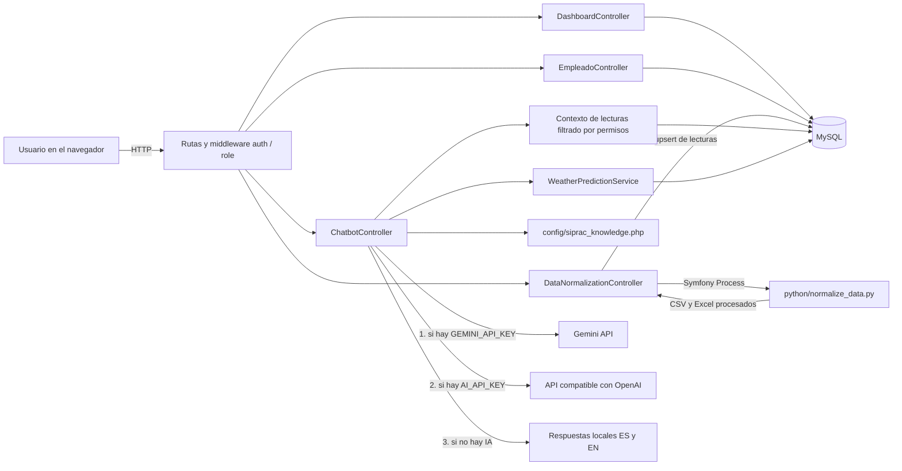
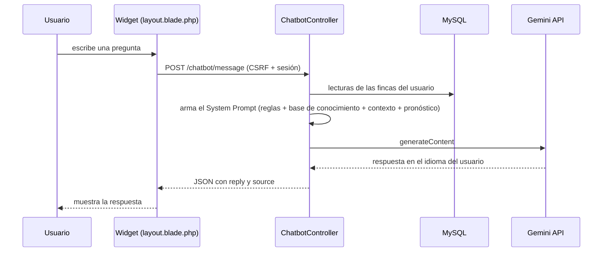

# SIPRAC — Sistema Inteligente de Protección Rural Agroclimática

Plataforma web que monitorea variables climáticas de estaciones meteorológicas en fincas de la provincia de Ubaté (Colombia), prepara y etiqueta los datos con machine learning, estima el clima de las próximas horas y ofrece un **asistente conversacional con IA (Google Gemini)** que responde en varios idiomas sobre el proyecto, las lecturas de cada usuario y el marco ético de la Universidad de Cundinamarca.

Proyecto desarrollado en la **Universidad de Cundinamarca** (Ingeniería de Sistemas y Computación).

> **English summary.** SIPRAC is a Laravel web platform for agroclimatic monitoring and frost/heavy-rain risk awareness. It ingests weather-station data, cleans and labels it with a Python/scikit-learn pipeline (IQR, Z-score, Isolation Forest, DBSCAN), computes an explainable hourly estimate, and includes an AI assistant powered by the **Gemini API** (with OpenAI and local fallbacks). The assistant is restricted by a system prompt, a structured knowledge base (including the Universidad de Cundinamarca *Transhuman Person Declaration*), and per-user data permissions. A bilingual reflection on the Declaration is included below.

---

## Contenido

1. [¿Qué es SIPRAC?](#1-qué-es-siprac)
2. [Funcionalidades](#2-funcionalidades)
3. [Asistente con IA (chatbot)](#3-asistente-con-ia-chatbot)
4. [Arquitectura](#4-arquitectura)
5. [Stack tecnológico](#5-stack-tecnológico)
6. [Estructura del proyecto](#6-estructura-del-proyecto)
7. [Roles y permisos](#7-roles-y-permisos)
8. [Modelo de datos](#8-modelo-de-datos)
9. [Instalación paso a paso](#9-instalación-paso-a-paso)
10. [Configuración del `.env`](#10-configuración-del-env)
11. [Uso y datos de prueba](#11-uso-y-datos-de-prueba)
12. [Rutas principales](#12-rutas-principales)
13. [Despliegue](#13-despliegue)
14. [Declaración de la Persona Transhumana](#14-declaración-de-la-persona-transhumana-ucundinamarca)
15. [Alcance actual y trabajo futuro](#15-alcance-actual-y-trabajo-futuro)
16. [Seguridad](#16-seguridad)
17. [Autor](#17-autor)

---

## 1. ¿Qué es SIPRAC?

Las heladas y las lluvias intensas causan pérdidas importantes en los cultivos de la provincia de Ubaté. SIPRAC busca que el agricultor **se anticipe**: reúne las lecturas de estaciones meteorológicas (temperatura, humedad, viento, lluvia), las limpia y analiza, estima las condiciones de las próximas horas y presenta la información de forma clara según el rol de cada persona (agricultor, empleado, técnico o administrador).

La decisión final siempre es de la persona: el sistema **informa y orienta, no decide ni actúa por ella**.

## 2. Funcionalidades

- **Autenticación y roles:** registro público (rol *solicitante*), inicio de sesión con límite de intentos y panel distinto por rol.
- **Dashboards por rol:** agricultor (fincas, estaciones, alertas, empleados, temperatura), técnico (fincas asignadas y estado de estaciones), administrador (usuarios, fincas, estaciones, últimas lecturas) y solicitante (vista de demostración mientras es verificado).
- **Gestión de empleados por finca:** el agricultor crea empleados y les asigna un nivel de permiso (1 = ver, 2 = alertas, 3 = control), los activa/desactiva o los remueve.
- **Preprocesamiento de datos (ML):** carga de archivos de la estación (`.xlsx`, `.xls`, `.csv`), limpieza, imputación, etiquetado de valores atípicos, descarga del Excel procesado y guardado de las lecturas en la base de datos.
- **Estimación de las próximas 12 horas:** pronóstico estadístico explicable con nivel de confianza.
- **Asistente con IA:** chatbot multiidioma integrado en todo el dashboard (ver sección 3).

## 3. Asistente con IA (chatbot)

El asistente está disponible como widget flotante en todas las pantallas del dashboard. Se ejecuta en el **backend** (la API key nunca llega al navegador).

**Qué hace**

- Explica SIPRAC, sensores IoT, heladas, lluvias, humedad, alertas y la normalización de datos.
- Responde con las **lecturas reales** de las estaciones a las que el usuario tiene acceso (última lectura por estación, última lluvia registrada y resumen de 7 días).
- Responde en el **idioma del usuario** (español, inglés, portugués, francés, etc.).
- Explica cómo el proyecto integra la **Declaración de la Persona Transhumana** de la Universidad de Cundinamarca, principio por principio.
- Rechaza con amabilidad lo que esté fuera de su alcance.

**Cómo está construido**

| Elemento | Detalle |
|---|---|
| Proveedor LLM | Google Gemini (`generateContent`, modelo `gemini-flash-latest`). Si no hay key de Gemini usa un proveedor compatible con OpenAI (opcional) y, si no hay ninguna, respuestas locales en español/inglés. |
| System Prompt | Define identidad, idioma, dominio permitido, honestidad con los datos y reglas de seguridad (no revelar instrucciones, no cambiar reglas). |
| Base de conocimiento | `config/siprac_knowledge.php`: marco institucional, los 12 principios de la declaración con su aplicación en SIPRAC, integración técnica y ejemplos *Few-Shot*. |
| Contexto de datos | Se arma en cada consulta y se **filtra por permisos**: el administrador ve todas las estaciones; los demás solo las de sus fincas (propias o asociadas y activas). |
| Pronóstico | `WeatherPredictionService` aporta la estimación local de las próximas horas, presentada como estimación y no como certeza. |
| Barreras | No inventa lecturas ni alertas, no activa mecanismos, no comparte datos de otras fincas y registra en el log los errores del proveedor. |
| Límite de uso | Ruta protegida por autenticación y limitada a 20 consultas por minuto. |

**Preguntas de ejemplo**

- "¿Cómo detecta SIPRAC una helada?"
- "Dame la última medición de la estación Ubaté Centro"
- "¿Cuándo llovió por última vez?"
- "How does SIPRAC reflect the Transhuman Person Declaration?"
- "¿Por qué el asistente no activa el riego por mí?"

## 4. Arquitectura

SIPRAC sigue el patrón **MVC de Laravel**, con dos piezas desacopladas: un **servicio de preprocesamiento en Python** (invocado como proceso por el backend) y un **servicio de IA** (API externa).



### Flujo de una pregunta al chatbot



### Pipeline de preprocesamiento (machine learning)

1. **Lectura flexible** de Excel, CSV estándar o la exportación `utf-16` de la estación.
2. **Centinelas** del sensor (`--`, `--.-`, `---`) convertidos a nulos.
3. **Imputación:** interpolación temporal limitada (~1 hora), mediana en rachas largas y viento, moda en la dirección del viento; cálculo de punto de rocío y sensación térmica si faltan.
4. **Detección de valores atípicos** con IQR, Z-score, Isolation Forest y DBSCAN. **No se eliminan observaciones:** se etiquetan, y `outlier_consenso` marca la coincidencia de los métodos disponibles (viento y lluvia extremos pueden ser eventos reales).
5. **Salidas:** Excel descargable (datos, resumen y outliers), CSV alineado con la tabla `lecturas` y una estimación de las próximas 12 horas.
6. Laravel importa el CSV con `upsert` sobre la llave única `(estacion_id, fecha_lectura)`, por lo que reprocesar un archivo no duplica lecturas.

## 5. Stack tecnológico

| Capa | Tecnología |
|---|---|
| Backend | PHP 8.2+, Laravel 12 |
| Base de datos | MySQL / MariaDB (SQLite también soportado por defecto en `.env.example`) |
| Frontend | Blade, HTML, CSS, JavaScript, Bootstrap 5.3, Bootstrap Icons, Chart.js 4 (por CDN) |
| ML / datos | Python 3, pandas, NumPy, scikit-learn, openpyxl |
| IA conversacional | Google Gemini API (con respaldo OpenAI-compatible y modo local) |
| Utilidades PHP | `league/csv` para importar lecturas, `symfony/process` para ejecutar Python |
| Calidad | Laravel Pint (formato), PHPUnit |

## 6. Estructura del proyecto

```
SIPRAC/
├── app/
│   ├── Console/Commands/ImportLecturasCommand.php   # php artisan import:lecturas {estacion_id}
│   ├── Http/
│   │   ├── Controllers/
│   │   │   ├── Auth/ (LoginController, RegisterController)
│   │   │   ├── Agricultor/EmpleadoController.php
│   │   │   ├── ChatbotController.php                # integración con el LLM
│   │   │   ├── DashboardController.php
│   │   │   └── DataNormalizationController.php
│   │   └── Middleware/CheckRole.php                  # control de acceso por rol
│   ├── Models/ (User, Role, Finca, Estacion, Lectura, Alerta, Activacion)
│   └── Services/WeatherPredictionService.php        # estimación de las próximas horas
├── config/
│   ├── services.php                                  # credenciales de Gemini / OpenAI
│   └── siprac_knowledge.php                          # base de conocimiento del chatbot
├── database/ (migrations, seeders, factories)
├── public/asset/ (css, js, imágenes)
├── python/normalize_data.py                          # preprocesamiento y outliers
├── resources/views/
│   ├── auth/ · agricultor/empleados/ · dashboard/
│   └── dashboard/layout.blade.php                    # layout + widget del chatbot
├── routes/web.php
└── .env.example
```

## 7. Roles y permisos

| Rol | Cómo se obtiene | Acceso |
|---|---|---|
| Solicitante | Se asigna automáticamente al registrarse | Vista de demostración con datos generales mientras es verificado |
| Agricultor | Lo asigna un administrador | Sus fincas, datos, alertas, preprocesamiento y gestión de empleados |
| Técnico | Lo asigna un administrador | Fincas asignadas, datos y estado de estaciones |
| Administrador | Usuario semilla | Todo el sistema |

Además del rol global, cada usuario puede estar asociado a una finca con un **nivel de permiso** (tabla `finca_usuario`): `1 = ver`, `2 = alertas`, `3 = control`. El middleware `CheckRole` valida el rol y cierra la sesión de cuentas desactivadas. El chatbot usa estos mismos permisos para decidir qué lecturas puede ver cada persona.

## 8. Modelo de datos

| Tabla | Descripción |
|---|---|
| `roles` | solicitante, agricultor, técnico, administrador |
| `users` | Usuarios con rol y estado activo |
| `fincas` | Propietario, ubicación, altitud, área y cultivo principal |
| `finca_usuario` | Empleados/técnicos asociados a una finca con su nivel de permiso |
| `estaciones` | Estaciones meteorológicas de una finca (MAC, batería, señal) |
| `lecturas` | Mediciones por estación y etiquetas de valores atípicos |
| `alertas` | Estructura para alertas de helada, lluvia, voltaje y errores de sensor |
| `activaciones` | Estructura para acciones de protección y su consumo de agua |

## 9. Instalación paso a paso

### Requisitos

- PHP 8.2 o superior (extensiones `mbstring`, `openssl`, `pdo_mysql`, `fileinfo`, `curl`)
- [Composer](https://getcomposer.org/)
- MySQL 8 o MariaDB
- Python 3.10 o superior
- Una API key gratuita de [Google AI Studio](https://aistudio.google.com/)

### Pasos

**1. Clonar el repositorio**

```bash
git clone <URL-DEL-REPOSITORIO>
cd SIPRAC
```

**2. Instalar dependencias de PHP**

```bash
composer install
```

**3. Crear el archivo de entorno y la llave de la aplicación**

```bash
cp .env.example .env        # en Windows (CMD): copy .env.example .env
php artisan key:generate
```

**4. Crear la base de datos y configurarla en `.env`**

```sql
CREATE DATABASE siprac CHARACTER SET utf8mb4 COLLATE utf8mb4_unicode_ci;
```

```env
DB_CONNECTION=mysql
DB_HOST=127.0.0.1
DB_PORT=3306
DB_DATABASE=siprac
DB_USERNAME=root
DB_PASSWORD=
```

**5. Instalar las dependencias de Python**

```bash
python -m venv venv
source venv/bin/activate          # Windows: venv\Scripts\activate
pip install -r python/requirements.txt
```

Si usas un entorno virtual, indica su intérprete en `.env` con `PYTHON_BIN` (ver sección 10).

**6. Ejecutar migraciones y datos iniciales (roles y usuarios de prueba)**

```bash
php artisan migrate --seed
```

**7. Configurar la API key de Gemini** en `.env` (ver sección 10) y limpiar la caché de configuración:

```bash
php artisan config:clear
```

**8. Iniciar el servidor**

```bash
php artisan serve
```

Abre `http://127.0.0.1:8000`.

> Las vistas usan Bootstrap y Chart.js por CDN, por lo que **no es necesario ejecutar `npm install`** para usar la aplicación.

## 10. Configuración del `.env`

Nunca subas tu `.env` ni pegues keys reales en el repositorio (el archivo ya está en `.gitignore`).

| Variable | Obligatoria | Descripción |
|---|---|---|
| `APP_KEY` | Sí | Se genera con `php artisan key:generate` |
| `APP_TIMEZONE` | Sí | `America/Bogota` |
| `DB_CONNECTION`, `DB_HOST`, `DB_PORT`, `DB_DATABASE`, `DB_USERNAME`, `DB_PASSWORD` | Sí | Conexión a MySQL |
| `SESSION_DRIVER`, `CACHE_STORE`, `QUEUE_CONNECTION` | Sí | `database` (las tablas las crean las migraciones) |
| `GEMINI_API_KEY` | Para el chatbot con IA | Key de Google AI Studio |
| `GEMINI_API_URL` | No | Por defecto `https://generativelanguage.googleapis.com/v1beta/models/gemini-flash-latest:generateContent`. Cámbiala solo si necesitas otro modelo |
| `AI_API_KEY`, `AI_API_URL`, `AI_MODEL` | No | Proveedor alternativo compatible con OpenAI (se usa solo si no hay `GEMINI_API_KEY`) |
| `PYTHON_BIN` | No | Intérprete de Python para el preprocesamiento. Por defecto `python` (Windows) o `python3` (Linux/Mac) |

Ejemplo (sin valores reales):

```env
GEMINI_API_KEY=
GEMINI_API_URL=https://generativelanguage.googleapis.com/v1beta/models/gemini-flash-latest:generateContent

# Opcional
AI_API_KEY=
AI_API_URL=https://api.openai.com/v1/chat/completions
AI_MODEL=gpt-4o-mini
PYTHON_BIN=
```

**Prioridad de proveedores del chatbot:** Gemini → OpenAI-compatible → respuestas locales. Si el proveedor falla, el error queda registrado en `storage/logs/laravel.log` y el asistente responde con el modo local.

## 11. Uso y datos de prueba

### Usuarios de prueba

`php artisan migrate --seed` crea cuatro usuarios de desarrollo (las contraseñas están en `database/seeders/DatabaseSeeder.php`; **cámbialas o elimina el seeder en cualquier entorno público**):

| Rol | Correo |
|---|---|
| Administrador | `admin@siprac.com` |
| Agricultor | `carlos@ejemplo.com` |
| Técnico | `marta@siprac.com` |
| Solicitante | `solicitante@ejemplo.com` |

### Crear una finca y una estación de ejemplo

El seeder no crea fincas ni estaciones. Para probar el preprocesamiento y el chatbot con datos, créalas con `php artisan tinker`:

```php
$carlos = App\Models\User::where('email', 'carlos@ejemplo.com')->first();

$finca = App\Models\Finca::create([
    'propietario_id' => $carlos->id,
    'nombre_finca' => 'Finca Demo',
    'vereda' => 'Centro',
    'municipio' => 'Ubaté',
    'altitud_msnm' => 2556,
    'area_hectareas' => 2.5,
    'cultivo_principal' => 'Papa',
]);

App\Models\Estacion::create([
    'mac_address' => 'AA:BB:CC:DD:EE:01',
    'nombre_estacion' => 'Estación Ubaté Centro',
    'finca_id' => $finca->id,
]);
```

### Cargar lecturas

1. Inicia sesión como agricultor o administrador.
2. Ve a **Preprocesamiento**, elige la estación y sube el archivo de la estación (`.xlsx`, `.xls` o `.csv`, máximo 20 MB). Columnas requeridas: fecha y hora, temperatura externa, humedad externa y velocidad del viento.
3. Revisa el resumen, la estimación de las próximas 12 horas y descarga el Excel procesado. Las lecturas quedan guardadas en la estación elegida.

Alternativa por consola, con un CSV ya limpio en `storage/app/imports/lecturas_limpias.csv`:

```bash
php artisan import:lecturas {estacion_id}
```

### Probar el chatbot

Abre el botón del asistente (esquina inferior derecha) y pregunta, por ejemplo: "Dame la última medición de la estación Ubaté Centro" o "How does SIPRAC reflect the Transhuman Person Declaration?".

## 12. Rutas principales

| Método y ruta | Descripción | Acceso |
|---|---|---|
| `GET /` | Página de bienvenida | Público |
| `GET/POST /register`, `GET/POST /login` | Registro e inicio de sesión (login limitado a 5 intentos por minuto) | Invitados |
| `GET /dashboard` | Panel según el rol | Autenticado |
| `GET /dashboard/datos` | Datos climáticos | Autenticado |
| `POST /chatbot/message` | Mensaje al asistente (limitado a 20 por minuto) | Autenticado |
| `GET /normalizacion`, `POST /normalizacion/normalizar`, `GET /normalizacion/descargar` | Preprocesamiento de datos | Agricultor, administrador |
| `GET/POST/PUT/DELETE /agricultor/empleados...` | Gestión de empleados por finca | Agricultor, administrador |

## 13. Despliegue

- **Enlace en vivo:** `PENDIENTE — agregar aquí la URL del despliegue`
- **Servicio utilizado:** `PENDIENTE (por ejemplo Railway o Render)`

Variables que se deben definir en el panel del servicio de despliegue (nunca en el código): `APP_KEY`, `APP_ENV=production`, `APP_DEBUG=false`, `APP_URL`, las `DB_*` de la base de datos MySQL del servicio y `GEMINI_API_KEY`. El entorno de ejecución debe incluir **PHP 8.2+ y Python 3 con las dependencias de `python/requirements.txt`**, porque el preprocesamiento se ejecuta como proceso desde Laravel.

---

## 14. Declaración de la Persona Transhumana (UCundinamarca)

El proyecto integra la **Declaración de la Persona Transhumana de la Universidad de Cundinamarca** de forma **conceptual** (principios de diseño: la persona decide, la tecnología es un medio, no se hace daño) y **técnica** (permisos por finca, restricción de dominio en el System Prompt, base de conocimiento con los 12 principios en `config/siprac_knowledge.php`, honestidad con los datos, outliers etiquetados y no eliminados, pronóstico explicable y asistente multiidioma). El propio chatbot puede explicar esta integración principio por principio.

A continuación se responden las dos preguntas reflexivas de la actividad, en español y en inglés.

### Español

**¿De qué manera el agente/chatbot respeta y fomenta los principios de la Declaración de la Persona Transhumana de la Universidad de Cundinamarca en el contexto del aprendizaje y la interacción tecnológica?**

La Declaración abre con la idea de que la persona organiza y dirige su propia vida, y se reconoce libre, autónoma y responsable, capaz de dictarse sus propias reglas a través del diálogo. En SIPRAC, ese principio se tradujo en una decisión de diseño concreta: el asistente nunca decide ni actúa en lugar del agricultor. Explica, orienta y presenta estimaciones indicando su nivel de confianza, pero la decisión de proteger un cultivo sigue en manos de quien conoce su finca. El asistente no activa mecanismos como el riego antiheladas ni afirma haberlos activado, y el sistema de permisos por finca (solo ver, recibir alertas o controlar) distribuye la responsabilidad según el rol de cada persona. Así, la autonomía va acompañada de responsabilidad, tal como lo plantea la Declaración.

La Declaración también habla de aprender de la propia vida y de las buenas prácticas de los semejantes, y de mejorarse y reinventarse cada día. En el plano del aprendizaje, el chatbot funciona como un acompañante pedagógico: responde en el idioma de quien pregunta y explica conceptos como las heladas, la humedad relativa o la lluvia acumulada, de modo que el agricultor no recibe solo una alerta, sino también el porqué detrás de ella. Para que ese aprendizaje sea confiable, el asistente responde únicamente con base en su base de conocimiento y en las lecturas reales de las estaciones a las que el usuario tiene acceso, y reconoce cuando un dato no está disponible en lugar de inventarlo. La misma lógica atraviesa el componente de machine learning: en el preprocesamiento los valores atípicos se etiquetan pero no se eliminan, porque una ráfaga o una lluvia extrema pueden ser eventos reales y relevantes, y el pronóstico horario es una estimación estadística explicable que muestra su confianza, de modo que cualquier persona puede revisar cómo se llegó a la conclusión.

La Declaración pide ir más allá de uno mismo, tomar la posición del otro, de los seres vivos y de la naturaleza, y elegir actos que no hagan daño a la sociedad, a la convivencia ni al entorno. SIPRAC nace precisamente para proteger los cultivos de familias agricultoras de la provincia de Ubaté frente a heladas y lluvias intensas, es decir, para cuidar el sustento de una comunidad y la vida vegetal de la que depende. El modelo de datos registra además el consumo de agua de cada activación de protección, lo que permite evaluar si el recurso se usa de forma responsable. El asistente aplica el mismo principio de no hacer daño: no emite alertas inventadas que lleven a gastar recursos o, peor aún, a confiarse sin motivo; no revela datos de fincas ajenas; y, si le preguntan algo fuera de su alcance, lo reconoce con honestidad.

Finalmente, la Declaración afirma que la persona se perfecciona no necesariamente a través de la tecnología y la ciencia. SIPRAC adopta esa humildad: los sensores y los modelos amplían la capacidad de observación del agricultor, pero no sustituyen su conocimiento del terreno ni el criterio de un agrónomo, y el asistente lo dice de forma explícita. El respeto por la dignidad, la diversidad y la no discriminación que subraya el texto institucional se refleja en que el asistente atiende a todas las personas con el mismo trato, en varios idiomas, sin requerir información personal sensible para funcionar. Y el cuidado del bienestar emocional, que la Declaración menciona junto con la salud corporal y mental, se refleja de manera modesta pero real en la reducción de la incertidumbre: saber a tiempo y con claridad qué puede ocurrir en la madrugada alivia la angustia de perder una cosecha.

---

### English

**How does the implemented AI agent/chatbot align with and support the Transhuman Person Declaration of Universidad de Cundinamarca regarding ethical AI integration, human augmentation, and educational transformation?**

*Ethical AI integration.* The Declaration begins with the idea that a person organizes and directs their own life and is free, autonomous, and responsible, able to set their own rules through dialogue. In SIPRAC, this became a concrete design rule: the assistant never decides or acts in place of the farmer. It explains, guides, and presents estimates together with their confidence level, but the decision to protect a crop stays with the person who knows the farm. The assistant does not trigger mechanisms such as anti-frost irrigation, nor does it claim to have done so, and the per-farm permission levels (view only, receive alerts, or control) distribute responsibility according to each person's role. Autonomy and responsibility therefore travel together, as the Declaration proposes. The same ethical stance appears in the machine learning pipeline: outliers are labeled but never deleted, because an extreme gust or downpour may be a real and relevant event, and the hourly forecast is an explainable statistical estimate that exposes its confidence instead of presenting itself as certainty.

The Declaration also asks that we go beyond ourselves, take the position of others, of living beings, and of nature, and choose actions that cause no harm to society, coexistence, or the environment. SIPRAC exists to protect the crops of farming families in the Ubaté province from frost and heavy rain, which means caring for a community's livelihood and the plant life it depends on. Its data model also records the water consumption of each protection activation so that the use of this resource can be evaluated. The assistant applies the same "do no harm" principle: it never fabricates alerts that could lead someone to waste resources or to feel falsely safe, it never reveals data from farms the user cannot access, and it openly acknowledges when a question is outside its scope.

*Human augmentation.* The Declaration states that a person improves themselves, not necessarily through technology and science. SIPRAC embraces that humility. Sensors and models extend the farmer's ability to observe conditions that are invisible or arrive in the middle of the night, but they do not replace local knowledge or an agronomist's judgment, and the assistant says so explicitly. Augmentation here means giving a person more and clearer information, never taking away their agency. Because the assistant answers in the user's own language and only from verified readings and its knowledge base, it also augments understanding without pretending to know what it does not.

*Educational transformation.* The Declaration speaks of learning from one's own life and from the good practices of others, and of improving and reinventing oneself every day. The chatbot works as a learning companion rather than a simple alert channel: it explains frost, relative humidity, or accumulated rainfall in clear language, so the farmer learns why a reading is worrying, not just that it is. Its answers are restricted to a structured knowledge base and real data, which makes the learning trustworthy, and its support for several languages widens access to that learning. Finally, the respect for dignity, diversity, and non-discrimination stressed in the institutional text is reflected in treating every user equally and in not needing sensitive personal information to function, while the Declaration's concern for emotional well-being is reflected, modestly but genuinely, in reducing uncertainty: knowing early and clearly what may happen before dawn eases the anxiety of losing a harvest.

---

## 15. Alcance actual y trabajo futuro

Para ser transparentes sobre el estado del proyecto:

**Funciona de extremo a extremo:** autenticación y roles, gestión de empleados con permisos, preprocesamiento con etiquetado de outliers, importación de lecturas, estimación de las próximas 12 horas, dashboards de agricultor/administrador/técnico con datos de la base y el asistente con IA con contexto por permisos.

**Parcial o con datos de ejemplo:**

- Las pantallas de *Alertas* y *Configuración*, el resumen de *Datos Climáticos* y la gráfica de 24 horas del agricultor muestran datos de ejemplo y aún no leen la base de datos.
- Las tablas `alertas` y `activaciones` están modeladas, pero la generación automática de alertas y la activación de mecanismos (riego antiheladas, drenaje) no están implementadas.
- La estimación de las próximas horas es un **modelo estadístico explicable** (promedios históricos ponderados por hora y lecturas recientes), no un modelo de machine learning entrenado.
- El asistente informa y orienta; no ejecuta operaciones CRUD ni acciones sobre la finca.

**Trabajo futuro:** alertas automáticas con notificaciones, conectar todas las pantallas a la base de datos, modelo predictivo entrenado y validado, integración en tiempo real con los sensores, pruebas automatizadas del chatbot y despliegue con contenedores.

## 16. Seguridad

- Las API keys viven solo en el `.env` del servidor y el navegador nunca las ve; el `.env` está excluido de Git.
- Autenticación por sesión con protección CSRF, límite de intentos de login y límite de consultas al chatbot.
- Control de acceso por rol (`CheckRole`) y por finca; el chatbot solo recibe datos de las fincas a las que el usuario tiene acceso.
- Contraseñas con *hash* (cast `hashed` de Laravel).
- Si una key se expone por error, revócala de inmediato en Google AI Studio y crea una nueva.

## 17. Autor

- **Autor:** Johan Steven Briceño Layton y Jhon Sebastian Murcia Romero
- **Programa:** Ingeniería de Sistemas y Computación — Universidad de Cundinamarca
- **Curso:** CADI Introducción a Machine Learning

Proyecto construido sobre el framework [Laravel](https://laravel.com), de código abierto bajo licencia [MIT](https://opensource.org/licenses/MIT).
