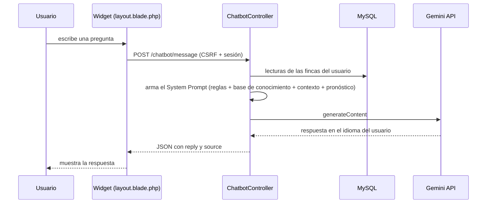

# SIPRAC — Sistema Inteligente de Protección Rural Agroclimática

Plataforma web que monitorea variables climáticas de estaciones meteorológicas en fincas de la provincia de Ubaté (Colombia), prepara y etiqueta los datos con machine learning, estima el clima de las próximas horas y ofrece un **asistente conversacional con IA** que responde en varios idiomas sobre el proyecto, las lecturas de cada usuario y el marco ético de la Universidad de Cundinamarca.

Proyecto desarrollado en la **Universidad de Cundinamarca** (Ingeniería de Sistemas y Computación).

> **English summary.** SIPRAC is a Laravel web platform for agroclimatic monitoring and frost/heavy-rain risk awareness. It ingests weather-station data, cleans and labels it with a Python/scikit-learn pipeline (IQR, Z-score, Isolation Forest, DBSCAN), computes an explainable hourly estimate, and includes an AI assistant powered by the **Gemini API** (with OpenAI and local fallbacks). The assistant is restricted by a system prompt, a structured knowledge base (including the Universidad de Cundinamarca *Transhuman Person Declaration*), and per-user data permissions. A bilingual reflection on the Declaration is included below.

---

## Contenido

1. [¿Qué es SIPRAC?](#1-qué-es-siprac)
2. [Asistente con IA (chatbot)](#2-asistente-con-ia-chatbot)
3. [Arquitectura](#3-arquitectura)
4. [Stack tecnológico](#4-stack-tecnológico)
5. [Estructura del proyecto](#5-estructura-del-proyecto)
6. [Roles y permisos](#6-roles-y-permisos)
7. [Instalación paso a paso](#7-instalación-paso-a-paso)
8. [Configuración del `.env`](#8-configuración-del-env)
9. [Despliegue](#9-despliegue)
10. [Declaración de la Persona Transhumana](#10-declaración-de-la-persona-transhumana-ucundinamarca)
11. [Autores](#11-autores)

---

## 1. ¿Qué es SIPRAC?

Las heladas y las lluvias intensas causan pérdidas importantes en los cultivos de la provincia de Ubaté. SIPRAC busca que el agricultor **se anticipe**: reúne las lecturas de estaciones meteorológicas (temperatura, humedad, viento, lluvia), las limpia y analiza, estima las condiciones de las próximas horas y presenta la información de forma clara según el rol de cada persona (agricultor, empleado, técnico o administrador).

La decisión final siempre es de la persona: el sistema **informa y orienta, no decide ni actúa por ella**.

## 2. Asistente con IA (chatbot)

El asistente está disponible como widget flotante en todas las pantallas del dashboard. Se ejecuta en el **backend** (la API key nunca llega al navegador).

**Qué hace**

- Explica SIPRAC, sensores IoT, heladas, lluvias, humedad, alertas y la normalización de datos.
- Responde con las **lecturas reales** de las estaciones a las que el usuario tiene acceso (última lectura por estación, última lluvia registrada y resumen de 7 días).
- Responde en el **idioma del usuario** (español, inglés, portugués, francés, etc.).
- Explica cómo el proyecto integra la **Declaración de la Persona Transhumana** de la Universidad de Cundinamarca, principio por principio.
- Rechaza con amabilidad lo que esté fuera de su alcance.

**Cómo está construido**

| Elemento | Detalle |
|---|---|
| Proveedor LLM | Google Gemini (`generateContent`, modelo `gemini-flash-latest`). Si no hay key de Gemini usa un proveedor compatible con OpenAI (opcional) y, si no hay ninguna, respuestas locales en español/inglés. |
| System Prompt | Define identidad, idioma, dominio permitido, honestidad con los datos y reglas de seguridad (no revelar instrucciones, no cambiar reglas). |
| Base de conocimiento | `config/siprac_knowledge.php`: marco institucional, los 12 principios de la declaración con su aplicación en SIPRAC, integración técnica y ejemplos *Few-Shot*. |
| Contexto de datos | Se arma en cada consulta y se **filtra por permisos**: el administrador ve todas las estaciones; los demás solo las de sus fincas (propias o asociadas y activas). |
| Pronóstico | `WeatherPredictionService` aporta la estimación local de las próximas horas, presentada como estimación y no como certeza. |
| Barreras | No inventa lecturas ni alertas, no activa mecanismos, no comparte datos de otras fincas y registra en el log los errores del proveedor. |
| Límite de uso | Ruta protegida por autenticación y limitada a 20 consultas por minuto. |

**Preguntas de ejemplo**

- "¿Cómo detecta SIPRAC una helada?"
- "Dame la última medición de la estación Ubaté Centro"
- "¿Cuándo llovió por última vez?"
- "How does SIPRAC reflect the Transhuman Person Declaration?"
- "¿Por qué el asistente no activa el riego por mí?"

## 3. Arquitectura

SIPRAC sigue el patrón **MVC de Laravel**, con dos piezas desacopladas: un **servicio de preprocesamiento en Python** (invocado como proceso por el backend) y un **servicio de IA** (API externa).

```mermaid
flowchart LR
    U[Usuario en el navegador] -->|HTTP| R[Rutas y middleware auth / role]
    R --> DC[DashboardController]
    R --> EC[EmpleadoController]
    R --> NC[DataNormalizationController]
    R --> CC[ChatbotController]

    DC --> DB[(MySQL)]
    EC --> DB

    NC -->|Symfony Process| PY[python/normalize_data.py]
    PY -->|CSV y Excel procesados| NC
    NC -->|upsert de lecturas| DB

    CC --> CTX[Contexto de lecturas filtrado por permisos]
    CTX --> DB
    CC --> KB[config/siprac_knowledge.php]
    CC --> WP[WeatherPredictionService]
    WP --> DB
    CC -->|"1. si hay GEMINI_API_KEY"| G[Gemini API]
    CC -->|"2. si hay AI_API_KEY"| O[API compatible con OpenAI]
    CC -->|"3. si no hay IA"| L[Respuestas locales ES y EN]
```



### Flujo de una pregunta al chatbot



### Pipeline de preprocesamiento (machine learning)

1. **Lectura flexible** de Excel, CSV estándar o la exportación `utf-16` de la estación.
2. **Centinelas** del sensor (`--`, `--.-`, `---`) convertidos a nulos.
3. **Imputación:** interpolación temporal limitada (~1 hora), mediana en rachas largas y viento, moda en la dirección del viento; cálculo de punto de rocío y sensación térmica si faltan.
4. **Detección de valores atípicos** con IQR, Z-score, Isolation Forest y DBSCAN. **No se eliminan observaciones:** se etiquetan, y `outlier_consenso` marca la coincidencia de los métodos disponibles (viento y lluvia extremos pueden ser eventos reales).
5. **Salidas:** Excel descargable (datos, resumen y outliers), CSV alineado con la tabla `lecturas` y una estimación de las próximas 12 horas.
6. Laravel importa el CSV con `upsert` sobre la llave única `(estacion_id, fecha_lectura)`, por lo que reprocesar un archivo no duplica lecturas.

## 4. Stack tecnológico

| Capa | Tecnología |
|---|---|
| Backend | PHP 8.2+, Laravel 12 |
| Base de datos | MySQL / MariaDB (SQLite también soportado por defecto en `.env.example`) |
| Frontend | Blade, HTML, CSS, JavaScript, Bootstrap 5.3, Bootstrap Icons, Chart.js 4 (por CDN) |
| ML / datos | Python 3, pandas, NumPy, scikit-learn, openpyxl |
| IA conversacional | Google Gemini API (con respaldo OpenAI-compatible y modo local) |
| Utilidades PHP | `league/csv` para importar lecturas, `symfony/process` para ejecutar Python |
| Despliegue | Docker, Render (aplicación) y Aiven (MySQL) |
| Calidad | Laravel Pint (formato), PHPUnit |

## 5. Estructura del proyecto

```
SIPRAC/
├── app/
│   ├── Console/Commands/ImportLecturasCommand.php   # php artisan import:lecturas {estacion_id}
│   ├── Http/
│   │   ├── Controllers/
│   │   │   ├── Auth/ (LoginController, RegisterController)
│   │   │   ├── Agricultor/EmpleadoController.php
│   │   │   ├── ChatbotController.php                # integración con el LLM
│   │   │   ├── DashboardController.php
│   │   │   └── DataNormalizationController.php
│   │   └── Middleware/CheckRole.php                  # control de acceso por rol
│   ├── Models/ (User, Role, Finca, Estacion, Lectura, Alerta, Activacion)
│   └── Services/WeatherPredictionService.php        # estimación de las próximas horas
├── config/
│   ├── services.php                                  # credenciales de Gemini / OpenAI
│   └── siprac_knowledge.php                          # base de conocimiento del chatbot
├── database/ (migrations, seeders, factories)
├── docker/ · Dockerfile                              # imagen para el despliegue en Render
├── public/asset/ (css, js, imágenes)
├── python/normalize_data.py                          # preprocesamiento y outliers
├── resources/views/
│   ├── auth/ · agricultor/empleados/ · dashboard/
│   └── dashboard/layout.blade.php                    # layout + widget del chatbot
├── routes/web.php
└── .env.example
```

## 6. Roles y permisos

| Rol | Cómo se obtiene | Acceso |
|---|---|---|
| Solicitante | Se asigna automáticamente al registrarse | Vista de demostración con datos generales mientras es verificado |
| Agricultor | Lo asigna un administrador | Sus fincas, datos, alertas, preprocesamiento y gestión de empleados |
| Técnico | Lo asigna un administrador | Fincas asignadas, datos y estado de estaciones |
| Administrador | Usuario semilla | Todo el sistema |

Además del rol global, cada usuario puede estar asociado a una finca con un **nivel de permiso** (tabla `finca_usuario`): `1 = ver`, `2 = alertas`, `3 = control`. El middleware `CheckRole` valida el rol y cierra la sesión de cuentas desactivadas. El chatbot usa estos mismos permisos para decidir qué lecturas puede ver cada persona.

## 7. Instalación paso a paso

### Requisitos

- PHP 8.2 o superior (extensiones `mbstring`, `openssl`, `pdo_mysql`, `fileinfo`, `curl`)
- [Composer](https://getcomposer.org/)
- MySQL 8 o MariaDB
- Python 3.10 o superior
- Una API key gratuita de [Google AI Studio](https://aistudio.google.com/)

### Pasos

**1. Clonar el repositorio**

```bash
git clone <URL-DEL-REPOSITORIO>
cd SIPRAC
```

**2. Instalar dependencias de PHP**

```bash
composer install
```

**3. Crear el archivo de entorno y la llave de la aplicación**

```bash
cp .env.example .env        # en Windows (CMD): copy .env.example .env
php artisan key:generate
```

**4. Crear la base de datos y configurarla en `.env`**

```sql
CREATE DATABASE siprac CHARACTER SET utf8mb4 COLLATE utf8mb4_unicode_ci;
```

```env
DB_CONNECTION=mysql
DB_HOST=127.0.0.1
DB_PORT=3306
DB_DATABASE=siprac
DB_USERNAME=root
DB_PASSWORD=
```

**5. Instalar las dependencias de Python**

```bash
python -m venv venv
source venv/bin/activate          # Windows: venv\Scripts\activate
pip install -r python/requirements.txt
```

Si usas un entorno virtual, indica su intérprete en `.env` con `PYTHON_BIN` (ver sección 8).

**6. Ejecutar migraciones y datos iniciales (roles y usuarios de prueba)**

```bash
php artisan migrate --seed
```

**7. Configurar la API key de Gemini** en `.env` (ver sección 8) y limpiar la caché de configuración:

```bash
php artisan config:clear
```

**8. Iniciar el servidor**

```bash
php artisan serve
```

Abre `http://127.0.0.1:8000`.

> Las vistas usan Bootstrap y Chart.js por CDN, por lo que **no es necesario ejecutar `npm install`** para usar la aplicación.

## 8. Configuración del `.env`

Nunca subas tu `.env` ni pegues keys reales en el repositorio (el archivo ya está en `.gitignore`).

| Variable | Obligatoria | Descripción |
|---|---|---|
| `APP_KEY` | Sí | Se genera con `php artisan key:generate` |
| `APP_TIMEZONE` | Sí | `America/Bogota` |
| `DB_CONNECTION`, `DB_HOST`, `DB_PORT`, `DB_DATABASE`, `DB_USERNAME`, `DB_PASSWORD` | Sí | Conexión a MySQL |
| `SESSION_DRIVER`, `CACHE_STORE`, `QUEUE_CONNECTION` | Sí | `database` (las tablas las crean las migraciones) |
| `GEMINI_API_KEY` | Para el chatbot con IA | Key de Google AI Studio |
| `GEMINI_API_URL` | No | Por defecto `https://generativelanguage.googleapis.com/v1beta/models/gemini-flash-latest:generateContent`. Cámbiala solo si necesitas otro modelo |
| `AI_API_KEY`, `AI_API_URL`, `AI_MODEL` | No | Proveedor alternativo compatible con OpenAI (se usa solo si no hay `GEMINI_API_KEY`) |
| `PYTHON_BIN` | No | Intérprete de Python para el preprocesamiento. Por defecto `python` (Windows) o `python3` (Linux/Mac) |

Ejemplo (sin valores reales):

```env
GEMINI_API_KEY=
GEMINI_API_URL=https://generativelanguage.googleapis.com/v1beta/models/gemini-flash-latest:generateContent

# Opcional
AI_API_KEY=
AI_API_URL=https://api.openai.com/v1/chat/completions
AI_MODEL=gpt-4o-mini
PYTHON_BIN=
```

**Prioridad de proveedores del chatbot:** Gemini → OpenAI-compatible → respuestas locales. Si el proveedor falla, el error queda registrado en `storage/logs/laravel.log` y el asistente responde con el modo local.

## 9. Despliegue

- **Enlace en vivo:** [https://siprac.onrender.com/dashboard](https://siprac.onrender.com/dashboard) (redirige al inicio de sesión si no hay una sesión activa)
- **Servicio de despliegue:** Render (Web Service con Docker)
- **Base de datos:** MySQL gestionada en Aiven, con conexión SSL
- **Despliegue continuo:** cada `git push` a la rama `main` reconstruye la imagen y redespliega la aplicación automáticamente; el contenedor ejecuta las migraciones al arrancar.

> Al usar el plan gratuito de Render, el servicio se suspende tras un periodo de inactividad, por lo que la primera carga puede tardar unos segundos.

Las variables de entorno se definen en el panel de Render (nunca en el código): `APP_KEY`, `APP_ENV=production`, `APP_DEBUG=false`, `APP_URL`, las `DB_*` de Aiven, `MYSQL_ATTR_SSL_CA`, `PYTHON_BIN` y `GEMINI_API_KEY`. La imagen Docker incluye PHP y Python 3 con las dependencias de `python/requirements.txt`, porque el preprocesamiento se ejecuta como proceso desde Laravel.

---

## 10. Declaración de la Persona Transhumana (UCundinamarca)

El proyecto tiene en cuenta la **Declaración de la Persona Transhumana de la Universidad de Cundinamarca** en la forma en que utiliza la tecnología. Su objetivo es ayudar a las personas, respetar sus decisiones y evitar causar daño. Esto se refleja en los permisos de acceso a cada finca, las reglas del chatbot, el manejo de los datos y las estimaciones del clima. Además, el asistente puede explicar cómo se relaciona SIPRAC con los 12 principios de la Declaración.

A continuación, se responden las dos preguntas de la actividad, en español y en inglés.

### Español

**¿De qué manera el agente/chatbot respeta y fomenta los principios de la Declaración de la Persona Transhumana de la Universidad de Cundinamarca en el contexto del aprendizaje y la interacción tecnológica?**

La Declaración destaca que cada persona es libre, autónoma y responsable de sus decisiones. En SIPRAC, esto significa que el asistente ayuda al agricultor a comprender la información del clima, pero no decide por él. El sistema presenta datos y estimaciones que sirven como orientación, mientras que el agricultor decide cómo proteger sus cultivos según las condiciones de su finca. Además, los permisos permiten que cada usuario acceda a las funciones que le corresponden. De esta manera, la tecnología sirve como apoyo y respeta la capacidad de cada persona para tomar sus propias decisiones.

La Declaración también resalta la importancia de aprender de las experiencias propias y de otras personas. En este sentido, el chatbot explica temas como las heladas, la humedad y las lluvias acumuladas mediante un lenguaje sencillo y en diferentes idiomas. Esto ayuda al agricultor a comprender mejor la información. El asistente también debe reconocer cuando no tiene información suficiente, en lugar de inventar respuestas. Por otra parte, durante el procesamiento de los datos, los valores que parecen extraños se identifican, pero no se eliminan automáticamente, ya que podrían representar situaciones reales, como una lluvia muy fuerte o una ráfaga de viento.

Otro principio de la Declaración es pensar en los demás y cuidar la naturaleza. SIPRAC busca apoyar a las familias agricultoras de la provincia de Ubaté frente a las heladas y las lluvias intensas que pueden afectar sus cultivos. El proyecto también contempla el registro del consumo de agua relacionado con las activaciones de protección, lo que puede ayudar a revisar cómo se utiliza este recurso. De igual manera, el chatbot debe ofrecer información responsable, respetar la privacidad de los usuarios y evitar presentar datos o alertas que no estén respaldados por la información disponible.

Finalmente, la Declaración recuerda que las personas pueden aprender y mejorar sin depender únicamente de la tecnología. Por eso, SIPRAC está pensado como una herramienta de apoyo para el agricultor, que tiene en cuenta su experiencia y los conocimientos de profesionales como los agrónomos. El sistema ofrece información que ayuda a comprender mejor las condiciones del clima, pero cada persona debe analizarla según su situación. Además, el chatbot busca comunicarse de forma clara y respetuosa, facilitando el acceso a la información en diferentes idiomas. De esta manera, la tecnología puede contribuir al aprendizaje, al cuidado de los cultivos y a una mejor preparación frente a los cambios del clima.

---

### English

**How does the implemented AI agent/chatbot align with and support the Transhuman Person Declaration of Universidad de Cundinamarca regarding ethical AI integration, human augmentation, and educational transformation?**

The Declaration highlights that every person is free, independent, and responsible for their own decisions. In SIPRAC, this means that the assistant helps farmers understand weather information but does not make decisions for them. The system provides data and estimates to guide them, while farmers decide how to protect their crops according to the conditions of their farms. Access permissions also help ensure that each user can only use the functions available for their role. In this way, technology supports people and respects their ability to make their own decisions.

The Declaration also emphasizes learning from personal experiences and from others. The chatbot supports this idea by explaining topics such as frost, humidity, and accumulated rainfall in simple language and different languages. This helps farmers better understand the information they receive. The assistant should also admit when it does not have enough information instead of inventing answers. In addition, during data processing, unusual values are identified but are not automatically removed, because they may represent real events, such as heavy rain or strong winds.

Another principle of the Declaration is to care about other people and the environment. SIPRAC aims to support farming families in the Ubaté province by helping them understand weather conditions that may affect their crops, especially frost and heavy rain. The project also includes a way to record water consumption related to protection activations, which can help evaluate how this resource is used. In the same way, the chatbot should provide responsible information, respect users' privacy, and avoid presenting data or alerts that are not supported by the available information.

Finally, the Declaration reminds us that people can learn and improve without depending only on technology. For this reason, SIPRAC is designed as a tool to support farmers while taking into account their experience and the knowledge of professionals such as agronomists. The system provides information that can help them better understand weather conditions, but each person must consider that information in their own situation. The chatbot also aims to communicate clearly and respectfully, making information available in different languages. In this way, technology can support learning, crop protection, and better preparation for changing weather conditions.

---

## 11. Autores

- **Johan Steven Briceño Layton**
- **Jhon Sebastian Murcia Romero**

**Programa:** Ingeniería de Sistemas y Computación — Universidad de Cundinamarca
**Curso:** CADI Introducción a Machine Learning

Proyecto construido sobre el framework [Laravel](https://laravel.com), de código abierto bajo licencia [MIT](https://opensource.org/licenses/MIT).
